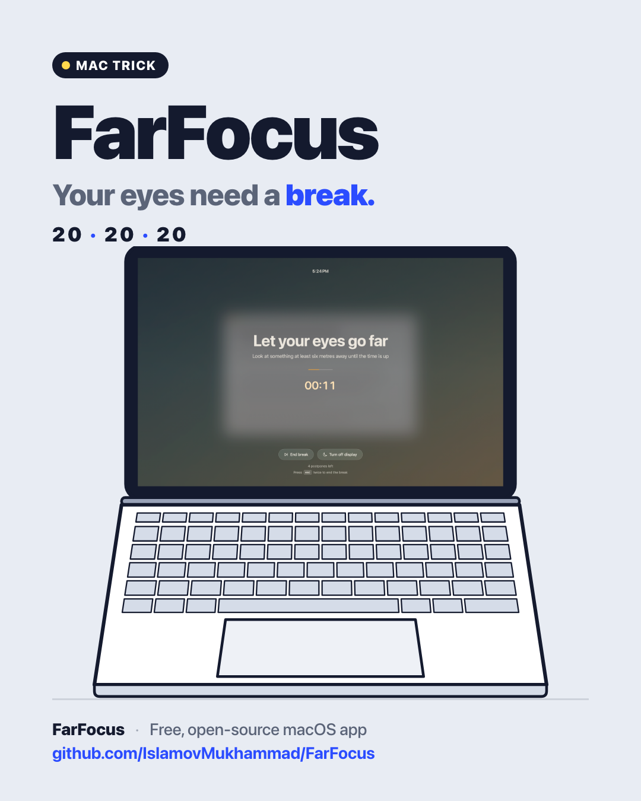
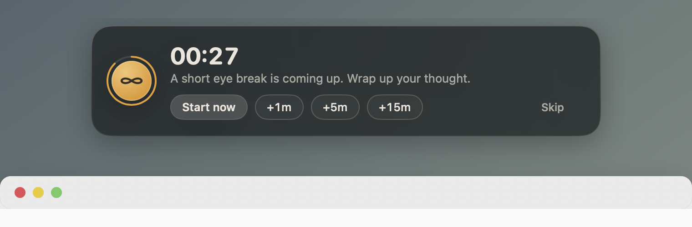
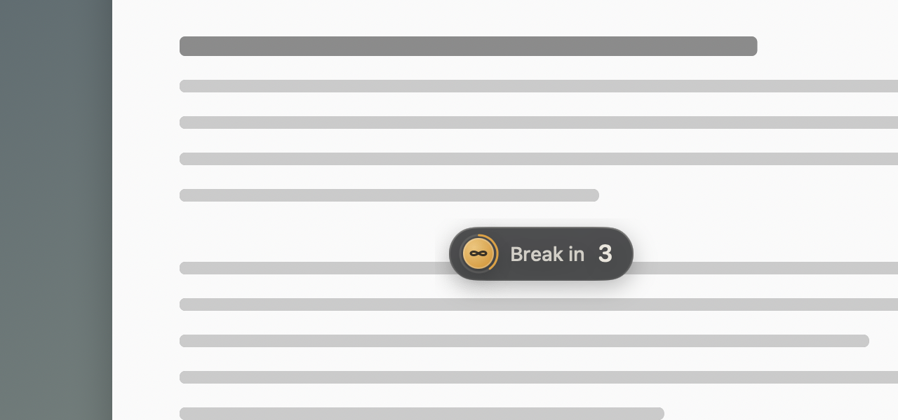
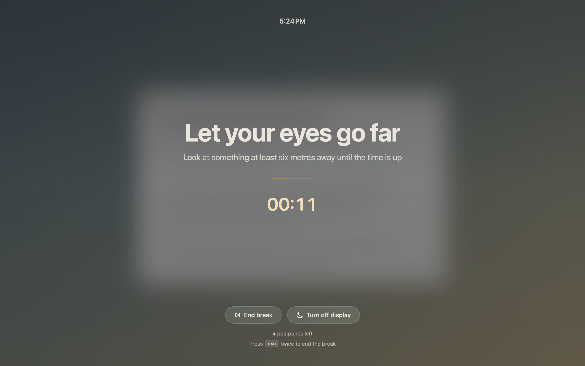
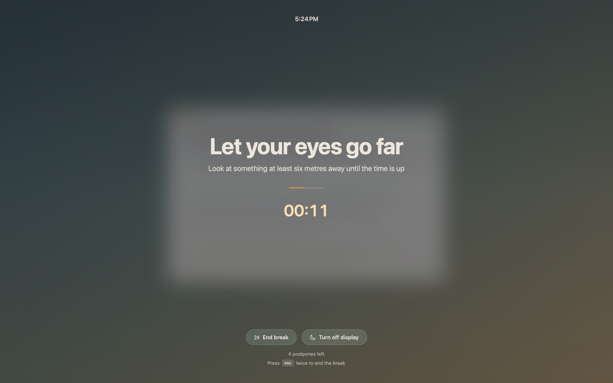
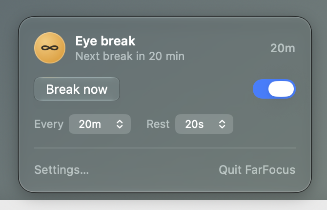
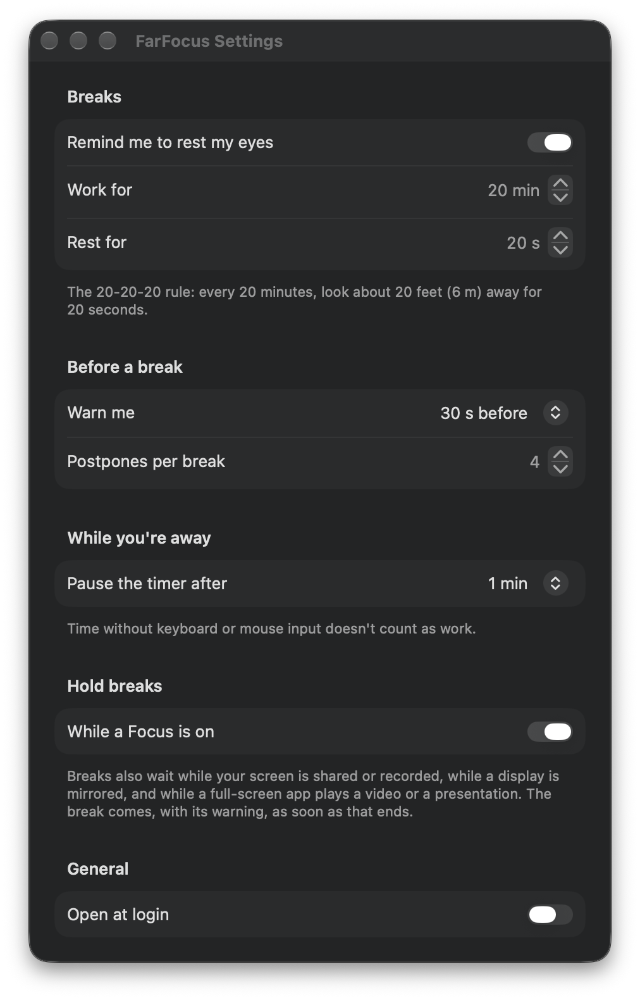

<p align="center">
  
</p>

# FarFocus

[](https://github.com/IslamovMukhammad/FarFocus/actions/workflows/ci.yml)

**Gentle 20-20-20 eye breaks for your Mac: a heads-up, a short countdown, then twenty seconds of looking far away.**

A free, open-source macOS menu-bar app. It never interrupts a meeting, a presentation or a movie, and it never
locks you in.

## How it works: the 20-20-20 rule

Every **20 minutes** of active work, look at something about **20 feet (6 m) away** for **20 seconds**.
FarFocus counts only the time you actually work, then walks you into the break in three calm steps:

1. **Warning card** (30 s before, at the top of the screen with your pointer): a full ring that drains, the time
   left, and **Start now**, **+1m**, **+5m**, **+15m** and **Skip**. It stays for 10 seconds, then floats away. It
   never takes your keyboard focus, so you can keep typing.
2. **Countdown** (5 s): a small "Break in 3" pill next to your pointer.
3. **Break** on **every display** at once: "Let your eyes go far", a thin amber line that fills as the break goes
   by, the time left, **End break** and **Turn off display**. The screen behind goes softly out of focus.

Then you're back to work and the next cycle starts.

## Features

- **Always an exit.** Press **Esc twice** (within 1.5 s, so a stray key can't end a break), click **End break**,
  and as a last resort an independent safety timer ends the break shortly after it is due. The screen can never
  stay covered.
- **Postpones.** +1m / +5m / +15m, up to 4 per break by default (0–10 in Settings). At zero, Start now and Skip
  still work.
- **Idle pause.** Without keyboard or mouse input for a minute (adjustable), the work timer stops.
- **Holds instead of interrupting.** A due break waits ("due" in the menu bar) while:
  - your screen is **shared or recorded**,
  - a display is **mirrored**,
  - a **full-screen app plays a video or a slideshow**,
  - a **Focus** is on (a setting, on by default).

  When that ends, the full warning comes first, so a break never arrives unannounced. A hold doesn't use a postpone.
- **Sleep and lock count.** If your Mac sleeps, its displays turn off or it's locked for at least a break's
  length, that counts as the break. Anything shorter resumes where it was.
- **Menu bar.** An ∞ with the minutes left (`18m`), seconds during the warning, `due` while held, dimmed when off.
  Click it for **Break now**, an on/off switch, quick **Every** and **Rest** pickers, Settings and Quit.
- **Settings.** Work and rest length, warning lead (10–90 s), postpones per break, idle threshold, hold during
  Focus, open at login. On/off is remembered.
- Reduce Motion and Reduce Transparency respected. Native SwiftUI + AppKit, no third-party dependencies,
  about 0 % CPU between breaks.

## Screenshots

**Warning card**



**Countdown next to the pointer**



**The break**



**…on every display at once** (here the second display)



| Menu-bar panel | Settings |
|---|---|
|  |  |

**Menu bar:**  normal ·  held

All screenshots use the app's demo mode on a made-up desk.

## Requirements

- macOS 26 or later
- Xcode 26 / Swift 6.2 toolchain to build

## Build from source

There is no prebuilt download. Build it yourself in a minute:

```bash
git clone https://github.com/IslamovMukhammad/FarFocus.git
cd FarFocus
./build.sh --install   # builds, copies to /Applications and launches
```

`./build.sh` alone puts the app in `build/FarFocus.app`. Run the tests with `swift test`.
The app icon is drawn in code: `swift Scripts/make_icon.swift` regenerates `Resources/AppIcon.iconset`.
Launch the app from Finder or with `open`, not by running the binary from a terminal.

## Permissions and privacy

- **Focus Status** is the only permission FarFocus asks for, once at launch while "Hold breaks while a Focus is
  on" is on. It only reads whether a Focus is on.
- **No Accessibility, Screen Recording or Input Monitoring.** The break windows take the keyboard while they're
  shown, so Esc works without any permission. A global Esc listener only ever reacts to the Esc key, and only
  if you've already granted Accessibility for another reason.
- To tell whether your screen is shared or recorded, FarFocus asks macOS a yes/no question
  (`SLSIsScreenWatcherPresent`, a private SkyLight call, looked up at runtime). To spot full-screen video it looks only at
  the **size** of the front app's windows and at macOS's display-sleep assertions. It never reads window titles or
  screen contents.
- **No network** code at all, no analytics. Settings are kept in the app's own preferences.
- **Turn off display** runs `pmset displaysleepnow` (which locks the Mac if your settings require a password).

## How it works (code)

| Part | File |
|---|---|
| The rules: phases, postpones, idle, holds, sleep (pure, unit-tested) | `Sources/FarFocus/Engine/FarFocusEngine.swift` |
| Timer, Esc, safety net, wiring | `Sources/FarFocus/App/FarFocusController.swift` |
| Screen sharing, mirroring, full-screen media, Focus | `Sources/FarFocus/System/HoldDetector.swift` |
| Sleep, lock and idle time | `Sources/FarFocus/System/SleepWatcher.swift`, `IdleTime.swift` |
| Warning card, countdown, break windows | `Sources/FarFocus/UI/` |

## Known limitations

- The screen-sharing check uses a private macOS call; if a future macOS removes it, that one check is skipped.
- Full-screen video and slideshow detection relies on display-sleep assertions, so an app that doesn't set them
  isn't detected.
- The Focus hold needs the Focus Status permission; without it, breaks don't wait for a Focus.
- English UI only.

Bug reports and pull requests are welcome.

## Credits

Originally built as part of the author's personal desk companion app.

## License

[MIT](LICENSE) © 2026 Muhammad Islamov

## Follow

- GitHub: [@IslamovMukhammad](https://github.com/IslamovMukhammad)
- Telegram: [t.me/infinitwo](https://t.me/infinitwo)
